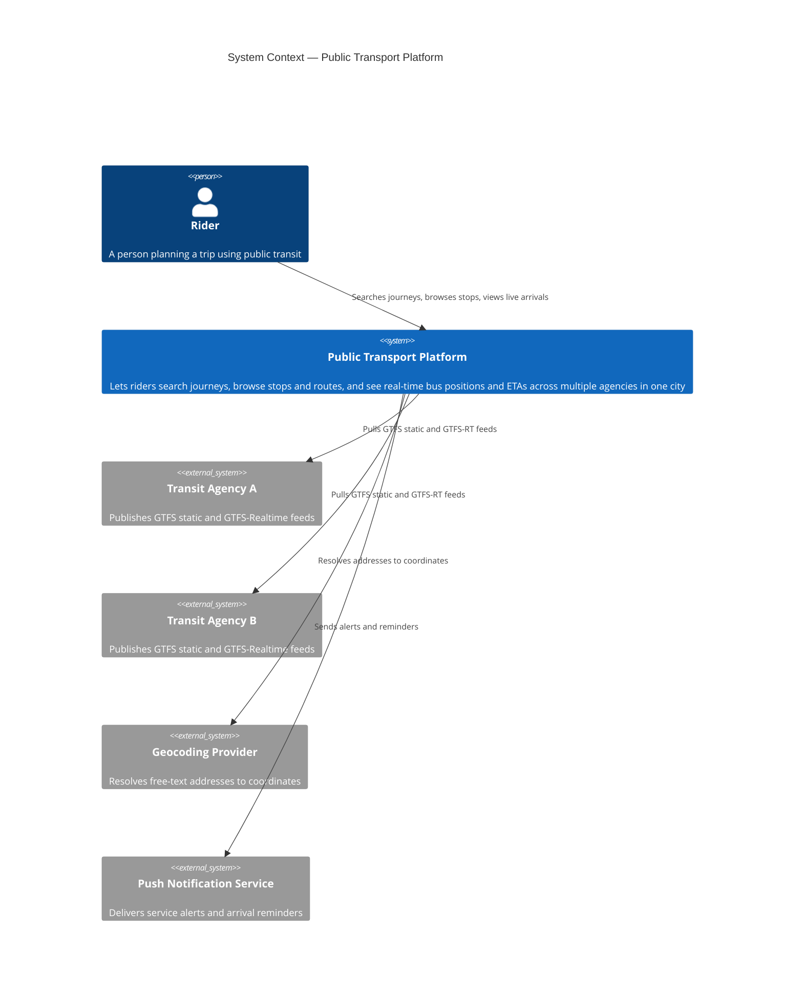

# C4 Level 1 — System Context

Shows the platform as a single black box, and how it relates to the people and external systems around it. No internal structure is shown at this level — that's intentional.

## Notes

- The platform is agency-agnostic by design: `agencyA` and `agencyB` are instances of the same relationship type (see ADR-001, ADR-003). Adding a third agency means adding another `System_Ext` node of the same shape, not a new kind of relationship.
- Geocoding and push notifications are outbound dependencies the platform calls, not systems that call into the platform.
- This diagram deliberately says nothing about routing algorithms, databases, or service boundaries — that's Level 2.
