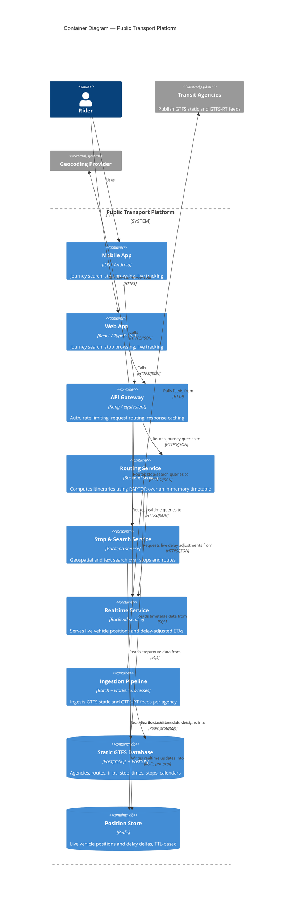

# C4 Level 2 — Container

Zooms into the platform from Level 1 and shows its deployable/runnable units (containers, in the C4 sense — not necessarily Docker containers, though here most of them are): apps, services, and data stores, plus how they talk to each other.

## Notes

- **Routing → Realtime Service** is the one synchronous inter-service call in the read path (used to adjust itinerary ETAs). It's called out explicitly here because it's the dependency most likely to need a circuit breaker / graceful degradation (see ADR-001, "Consequences").
- **Ingestion Pipeline** is drawn as a single container for simplicity, but per ADR-005 it actually runs as one process per agency for the realtime side, plus a separate scheduled job for static feeds. See the Level 3 diagram for that internal structure.
- Postgres and Redis are shown as containers here (they're separately deployable/scalable units) even though they're data stores rather than services — this is standard C4 practice.
