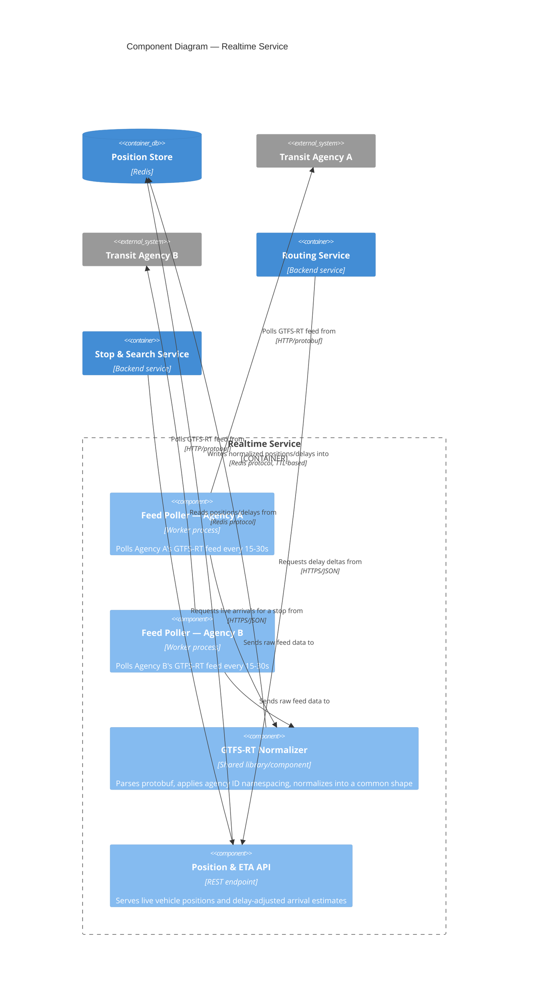

# C4 Level 3 — Component: Realtime Service

Zooms into the Realtime Service container from Level 2. Reflects the per-agency isolation decision in ADR-005: each agency's feed is handled by its own poller component, not a shared loop.

## Notes

- **One poller component per agency** is the direct implementation of ADR-005: a crash or hang in `Feed Poller — Agency A` cannot block or slow down `Feed Poller — Agency B`. Onboarding a new agency means adding a new poller component, not modifying existing ones.
- **GTFS-RT Normalizer** is shared *code*, not a shared *process* — each poller uses it as a library so parsing/namespacing logic doesn't drift between agencies, but each poller still runs and fails independently.
- **Position & ETA API** is the single read surface other services depend on, so that the internal poller/normalizer structure can change without affecting Routing Service or Stop & Search Service's integration.
