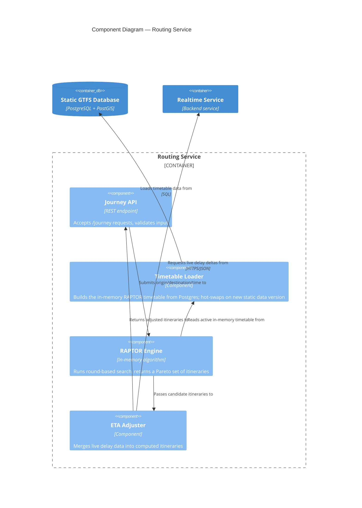

# C4 Level 3 — Component: Routing Service

Zooms into the Routing Service container from Level 2 and shows the components inside it.

## Notes

- **Timetable Loader** and **RAPTOR Engine** are deliberately separate components: the loader owns the ingestion-time concern (build, validate, hot-swap), while the engine only ever reads the currently active version. This separation is what makes the blue-green swap (see SAD §6.2, ADR-002) safe — the engine never sees a half-built timetable.
- **ETA Adjuster** calling out to the Realtime Service is the one external dependency in this container. If that call fails or times out, the intended behavior is graceful degradation: return static-schedule itineraries without live adjustment, rather than failing the whole request (see ADR-001, "Consequences").
- This is the component breakdown as currently designed. It is expected to evolve as the RAPTOR implementation matures — e.g., a future "Transfer Cache" component if precomputed transfers move out of `Timetable Loader`.
