# Implementation Roadmap — Public Transport Platform

Breaks the architecture (see SAD, ADRs, C4 docs) into buildable phases. Each phase produces something demonstrable; later phases depend on earlier ones being stable, not just "in progress."

## Phase overview

```mermaid
gantt
    title Public Transport Platform — Phase Overview
    dateFormat  X
    axisFormat %s
    section Phase 0
    Foundations           :p0, 0, 3
    section Phase 1
    Core journey search MVP :p1, after p0, 4
    section Phase 2
    Multi-agency support   :p2, after p1, 3
    section Phase 3
    Realtime layer         :p3, after p2, 4
    section Phase 4
    Hardening & scale      :p4, after p3, 3
```

*(Units are relative sprints, not fixed dates — use to sequence and size, not as a committed calendar.)*

---

## Phase 0 — Foundations

**Goal:** infra and data pipeline exist; nothing user-facing yet.

| ID | Task | Depends on | Notes |
|---|---|---|---|
| 0.1 | Define agency onboarding process & ID namespacing scheme | — | Implements ADR-003 |
| 0.2 | Postgres + PostGIS schema for GTFS static tables | — | Implements ADR-004 |
| 0.3 | GTFS static validator (structural + referential integrity) | 0.2 | Must reject bad feeds before they load — see SAD §10 risk |
| 0.4 | GTFS static ingestion job (single agency, manual trigger) | 0.1, 0.3 | No hot-swap yet, just load |
| 0.5 | Redis cluster provisioned | — | Implements ADR-004 |
| 0.6 | API Gateway skeleton (routing, no auth yet) | — | |
| 0.7 | CI/CD pipeline for all services | — | |
| 0.8 | Baseline observability: structured logging, correlation IDs, metrics scaffolding | 0.6 | Needed before Phase 1 so early bugs are debuggable |

**Exit criteria:** one agency's static GTFS feed can be pulled, validated, and loaded into Postgres on demand.

---

## Phase 1 — Core Journey Search MVP (single agency, static schedule only)

**Goal:** a user can search a journey and get real, correct itineraries — no realtime yet.

| ID | Task | Depends on | Notes |
|---|---|---|---|
| 1.1 | Timetable Loader: build in-memory RAPTOR structure from Postgres | 0.4 | See C4 Level 3 (Routing) |
| 1.2 | Precompute walking transfers between nearby stops | 1.1 | Feeds RAPTOR's transfer step |
| 1.3 | RAPTOR engine implementation | 1.1, 1.2 | Implements ADR-002. See tech spec for detailed behavior |
| 1.4 | `/journey` API endpoint | 1.3 | See journey search tech spec for full contract |
| 1.5 | Stop & Search Service: nearby-stop geospatial query | 0.2 | `ST_DWithin`/KNN via PostGIS |
| 1.6 | Stop & Search Service: stop detail, route detail, static schedule display | 0.2 | |
| 1.7 | Mobile/web client integration against `/journey` and `/stops/nearby` | 1.4, 1.5 | First end-to-end demo |
| 1.8 | Golden-itinerary regression test suite | 1.4 | Known origin/destination/time → known expected itinerary, run on every change to the routing engine |

**Exit criteria:** a rider can search a real journey on one agency's network and get correct, multi-option results within the NFR-1 latency target.

---

## Phase 2 — Multi-Agency Support

**Goal:** the MVP works with more than one agency in the same city.

| ID | Task | Depends on | Notes |
|---|---|---|---|
| 2.1 | Extend ingestion to load N agencies with namespaced IDs | 0.1, 0.4 | |
| 2.2 | Cross-agency transfer precomputation (walking between agencies' stops) | 1.2, 2.1 | The trickiest part of ADR-003's "not merging co-located stops" decision |
| 2.3 | Per-agency validation isolation (one bad feed doesn't block others) | 0.3, 2.1 | Implements SAD §10 risk mitigation |
| 2.4 | Timetable Loader updated for merged multi-agency graph | 1.1, 2.1 | |
| 2.5 | UI handling for "co-located stops from different agencies" | 2.2 | Product/UX decision flagged in ADR-003 |

**Exit criteria:** a journey can span two agencies with a correctly modeled transfer between them.

---

## Phase 3 — Realtime Layer

**Goal:** live vehicle positions and delay-adjusted ETAs, per ADR-005.

| ID | Task | Depends on | Notes |
|---|---|---|---|
| 3.1 | GTFS-RT normalizer library (shared parsing/namespacing code) | 2.1 | Used by every poller |
| 3.2 | Per-agency feed poller worker (one process per agency) | 3.1 | Implements ADR-005 |
| 3.3 | Redis position/delay schema + TTL strategy | 0.5, 3.2 | |
| 3.4 | Position & ETA API (Realtime Service) | 3.3 | |
| 3.5 | ETA Adjuster component in Routing Service | 1.3, 3.4 | Synchronous call — must degrade gracefully on failure |
| 3.6 | Live vehicle position endpoint for map rendering | 3.4 | |
| 3.7 | Per-agency feed health monitoring & alerting | 3.2 | Staleness beyond NFR-3 threshold triggers alert |

**Exit criteria:** itineraries reflect live delays, and a rider can see a bus's current position on a map.

---

## Phase 4 — Hardening & Scale

**Goal:** production-ready under real load, across the full agency set.

| ID | Task | Depends on | Notes |
|---|---|---|---|
| 4.1 | Load test `/journey` at target peak QPS | 1.4, 3.5 | Validate NFR-1 under realistic concurrency |
| 4.2 | Automate blue-green timetable swap + rollback | 1.1, 2.4 | Zero-downtime static updates (NFR-5) |
| 4.3 | Full alerting suite (feed staleness, ingestion failures, latency SLO breaches) | 3.7, 4.1 | |
| 4.4 | Mobile offline caching of last-known schedule | 1.7 | Implements NFR-8 |
| 4.5 | Revisit in-memory timetable size vs. pod memory budget | 2.4 | Tracked risk from SAD §10 — decide if partitioning is needed |

**Exit criteria:** system meets all NFRs from the SAD under production-representative load, with alerting in place for the known risks.

---

## Sequencing notes

- **Phase 1 must be solid before Phase 2** — multi-agency support multiplies whatever bugs exist in the single-agency routing logic across every agency pair's transfers.
- **Phase 3 can start its infrastructure work (3.1–3.3) in parallel with late Phase 2**, since realtime ingestion doesn't depend on multi-agency static routing being finished — only the ETA Adjuster integration (3.5) needs Phase 1's RAPTOR engine.
- **4.5 (memory/partitioning) is a decision point, not a guaranteed task** — only build it if 4.1's load test or real agency growth shows it's needed. Don't build it speculatively.
