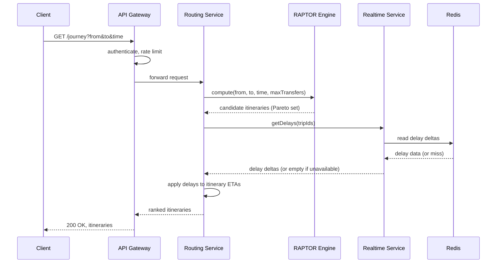

# Technical Specification: Journey Search

| | |
|---|---|
| **Flow** | Rider searches a journey from origin to destination |
| **Owning containers** | API Gateway → Routing Service (→ Realtime Service) |
| **Related docs** | SAD §6.1, ADR-002, C4 Level 3 (Routing Service) |
| **Status** | Draft — for Phase 1 implementation |

## 1. Overview

This is the platform's core flow: a rider provides an origin, a destination, and a time, and receives a ranked set of itinerary options. Everything else in the product (stop browsing, live tracking) supports this flow or is supported by its output.

## 2. Actors and Preconditions

- **Actor:** Rider, via mobile or web client
- **Precondition:** At least one agency's static GTFS feed has been successfully ingested and is active (Phase 1); realtime adjustment is optional and degrades gracefully if unavailable (Phase 3+)

## 3. API Contract

### Request

```
GET /journey
```

| Param | Type | Required | Description |
|---|---|---|---|
| `from` | `lat,lng` or `stop_id` | Yes | Origin coordinate or namespaced stop ID |
| `to` | `lat,lng` or `stop_id` | Yes | Destination coordinate or namespaced stop ID |
| `time` | ISO 8601 datetime | No (default: now) | Departure time, unless `arriveBy=true` |
| `arriveBy` | boolean | No (default: false) | If true, `time` is treated as desired arrival time |
| `maxTransfers` | integer | No (default: 3) | Caps RAPTOR round count |
| `maxWalkMeters` | integer | No (default: 800) | Max walking distance for access/egress/transfer legs |

### Response — `200 OK`

```json
{
  "query": {
    "from": { "lat": 37.7749, "lng": -122.4194 },
    "to": { "lat": 37.7955, "lng": -122.3937 },
    "departAt": "2026-09-19T08:15:00Z"
  },
  "itineraries": [
    {
      "id": "itin_01",
      "rank": "fastest",
      "departAt": "2026-09-19T08:17:00Z",
      "arriveAt": "2026-09-19T08:42:00Z",
      "durationSeconds": 1500,
      "transfers": 1,
      "walkMeters": 320,
      "realtime": true,
      "legs": [
        {
          "mode": "walk",
          "durationSeconds": 240,
          "from": { "name": "Origin", "lat": 37.7749, "lng": -122.4194 },
          "to": { "stopId": "AGENCY_A:stop_1123", "name": "Main St & 5th Ave" }
        },
        {
          "mode": "bus",
          "agencyId": "AGENCY_A",
          "routeId": "AGENCY_A:route_38",
          "routeName": "38 Geary",
          "tripId": "AGENCY_A:trip_4471",
          "departAt": "2026-09-19T08:21:00Z",
          "arriveAt": "2026-09-19T08:36:00Z",
          "delaySeconds": 60,
          "from": { "stopId": "AGENCY_A:stop_1123", "name": "Main St & 5th Ave" },
          "to": { "stopId": "AGENCY_A:stop_2044", "name": "Park Ave & 12th St" },
          "stopSequence": ["AGENCY_A:stop_1123", "...", "AGENCY_A:stop_2044"]
        },
        {
          "mode": "walk",
          "durationSeconds": 300,
          "from": { "stopId": "AGENCY_A:stop_2044", "name": "Park Ave & 12th St" },
          "to": { "name": "Destination", "lat": 37.7955, "lng": -122.3937 }
        }
      ]
    }
  ]
}
```

### Response — Error cases

| Status | Condition | Body |
|---|---|---|
| `400` | Invalid/missing `from` or `to` | `{ "error": "invalid_location", "message": "..." }` |
| `422` | `time` is in the past by more than a defined tolerance, or beyond the static schedule's calendar horizon | `{ "error": "time_out_of_range", "message": "..." }` |
| `200` (empty) | No itinerary found (e.g., destination unreachable, no service at that time) | `{ "itineraries": [] }` — **not** a 404; an empty result is a valid answer |
| `503` | Timetable not yet loaded (e.g., during initial deploy) | `{ "error": "service_unavailable" }` |

## 4. Sequence Diagram



Note: if the call to Realtime Service fails or times out (budgeted at 150ms, see §7), Routing Service proceeds with **static** ETAs and marks each affected itinerary's `realtime` field as `false` — the request never fails solely because realtime data is unavailable.

## 5. Processing Detail — RAPTOR Execution

1. **Resolve endpoints**: if `from`/`to` are coordinates, find nearby stops within `maxWalkMeters` as access/egress candidates (via Stop & Search Service's geospatial index, or a local copy of it)
2. **Round 0**: mark all access stops as reachable at the walk-adjusted arrival time
3. **Each subsequent round** (up to `maxTransfers`): for every route passing through a currently-reachable stop, scan forward for the earliest trip catchable, and update arrival times at all downstream stops on that trip; then apply precomputed walking transfers from those stops
4. **Termination**: stop after `maxTransfers` rounds or when no further improvement is found
5. **Itinerary extraction**: walk back through the round-by-round arrival records to reconstruct full itineraries; keep the Pareto-optimal set (not strictly dominated on both arrival time and transfer count)
6. **Ranking for response**: label the minimum-arrival-time itinerary `"fastest"`; include up to 2–3 alternatives (fewer transfers, less walking) labeled accordingly

## 6. Edge Cases

| Case | Expected behavior |
|---|---|
| Origin and destination resolve to the same stop | Return `itineraries: []` with a client-facing message suggesting the locations are effectively the same place, rather than a walk-only "itinerary" |
| No service running at requested time (e.g., 3am with no night service) | Return `itineraries: []`; consider a future enhancement to suggest the next time service is available |
| Destination unreachable within `maxTransfers` | Return `itineraries: []`; do not silently raise `maxTransfers` — respect the caller's constraint |
| One agency's data is stale/failed ingestion but another is fine | Journey search still runs against whichever agencies have valid active data; do not fail the whole query for one agency's ingestion problem |
| Realtime Service unavailable | Degrade to static ETAs (`realtime: false`); never block or fail the request on this dependency |
| `arriveBy=true` | RAPTOR runs in reverse (or via a backward search variant) — flagged as a distinct code path, not the default forward search with time subtracted after the fact |

## 7. Non-Functional Requirements for This Flow

| Requirement | Target | Notes |
|---|---|---|
| End-to-end p95 latency | < 800ms (NFR-1) | Budget: ~50ms gateway overhead, ~500ms RAPTOR computation, ~150ms realtime call (with timeout), ~100ms serialization/network |
| Realtime call timeout | 150ms | Beyond this, proceed without realtime data rather than waiting |
| Concurrency | Support target peak QPS per SAD capacity planning (see Phase 4 load test, roadmap 4.1) | Routing Service pods are stateless aside from the in-memory timetable, so scale horizontally |

## 8. Testing Strategy

- **Unit tests**: RAPTOR correctness against hand-constructed small timetables with known optimal itineraries, including edge cases (no service, same-stop origin/destination, exactly-at-transfer-limit cases)
- **Golden itinerary regression tests** (roadmap 1.8): fixed real-world origin/destination/time combinations with expected itineraries, re-run on every change to the routing engine or timetable format
- **Integration tests**: full request through Gateway → Routing → Realtime (with Realtime Service mocked to simulate both success and failure/timeout) to verify graceful degradation
- **Load tests**: sustained and burst QPS at target scale, verifying the p95 latency target holds as concurrent requests increase

## 9. Open Questions

- Exact definition of "longest route" for the alternatives list — is it useful to riders at all, or should the response only ever return fastest + meaningfully different alternatives? (Flagged as a risk in SAD §10 — needs product input before Phase 1 UI work finalizes.)
- Whether `maxTransfers` and `maxWalkMeters` defaults should be user-configurable in the client UI or fixed platform-wide constants for the MVP.
- Behavior when a rider's origin/destination is technically reachable but only via an extremely indirect route (e.g., 5+ transfers) — should the platform cap suggestions even below `maxTransfers` if the result would be impractical?
